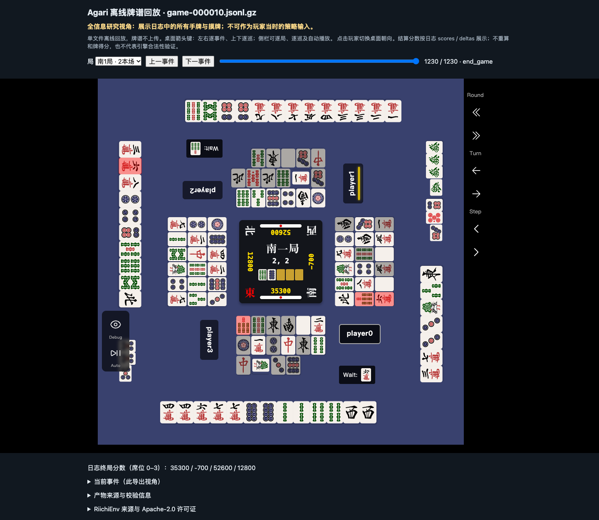

# 离线回放验收记录

2026-10-28，在实现提交 `ae0ad882b6fa8dce5e979349c5b178acc220dcf3` 上完成独立 HTML
回放验收。使用真实训练分区牌谱，在禁用网络的隔离 Chrome 中检查实际桌面渲染与交互，
包括事件前进／回退、切局、进度拖动、结算分数和玩家暗牌投影。没有运行新训练或线上连接。

[CLI 用法与限制](../../README.md#离线回放) ·
[浏览器回归代码](../../tests/browser/test_replay.py) ·
[原始浏览器机器记录](evidence.json)

```sh
agari replay /path/game.jsonl.gz --output /path/new-replay.html
agari replay /path/game.jsonl.gz --player 0 --output /path/new-player-0.html
```

## 实际终局与回退

下图是全信息 HTML 在原始 `end_game` 步骤的 Chrome 截图，未修改图像。



本次机器记录对应本机自博弈数据集 `meld-coverage-v1` 的 `game-000010.jsonl.gz`，
在冻结 `split-v1.json` 中属于 `train` 分区。共有 1,231 个原始事件、10 局；
浏览器导航包含除 `start_game` 外的 1,230 个事件。没有读取 held-out 对局内容。

| 原始记录位置 | 席位 0 | 席位 1 | 席位 2 | 席位 3 |
| --- | ---: | ---: | ---: | ---: |
| 最后一局结算 | 35,300 | -700 | 50,600 | 12,800 |
| `end_game` | 35,300 | -700 | 52,600 | 12,800 |

终局将剩余 2,000 点立直供托交给首位玩家。测试逐事件前进确认牌桌变为终局分数，
再回退确认恢复末局结算分数；全信息与玩家 0 两种导出均通过。实现保留独立的原始
`end_game`，没有改写 `hora`／`ryukyoku` 来伪造分数一致。合成显示测试另覆盖
红牌、吃、碰、明杠、暗杠、加杠和跨事件回退；这些合成用例不宣称麻将规则合法。

## 数据边界与来源

默认导出明确标记为全信息研究视角。`--player 0..3` 使用现有玩家事件白名单，
在写入 HTML 前移除其他玩家的起手暗牌、未公开摸牌以及任意分析注释；切换桌面朝向
不会恢复这些牌。该保守投影暂不补录和牌／流局时揭示的对手手牌。两种导出都包含
整场历史、未来事件及终局信息，均不能作为玩家当时的策略输入。

导出的 `validation` 保持 `structural-only`。分数来自原始 `scores`，或按记录中的
立直扣点和 `deltas` 顺序累计；不重算役种、符数或和牌得分。此显示验收不能替代
`agari data validate --trace ...` 的引擎验证，也不能凭浏览器显示正常认定未知牌谱合法。

回放内联已安装的固定 [RiichiEnv v0.4.10](https://github.com/smly/RiichiEnv/tree/v0.4.10)
原始 `viewer.js.gz`，包括牌面与 WASM，无 CDN 或运行时网络加载。资产未修改；
离线外壳增加日志分数和隐藏牌数量适配。HTML 附完整 Apache-2.0 许可证和上游
`Copyright 2026 Kohei Ozaki`。截图展示同一 [Apache-2.0](../../LICENSE) 上游 UI；所用牌谱由本机
自博弈生成，不涉及第三方牌谱再分发。

## 命令与结果

以下命令在该实现上完成；隔离 worktree 通过 `PYTHONPATH=src` 选用本分支源码，
借用既有固定依赖的 Python 3.12 环境，没有修改其依赖。本机实际解释器为
`/Users/zhou/MyCodes/AgariLab/agari-kit/.venv/bin/python`；下表和复跑示例中的
`.venv/bin/python` 是安装好固定依赖后的仓库环境写法。表中结果是最终执行结果。

| 检查 | 命令 | 结果 |
| --- | --- | --- |
| 普通测试 | `PYTHONPATH=src .venv/bin/python -m unittest discover -s tests -q` | 101 项通过，3.106 秒 |
| 引擎集成 | `PYTHONPATH=src .venv/bin/python -m unittest discover -s tests/integration -v` | 38 项完成，37 通过、1 项既有 expected failure，1.834 秒 |
| 实际 Chrome | 下方命令 | 4 项通过，4.130 秒 |
| wheel | `uv build --offline --cache-dir /Volumes/新加卷/AgariLab/cache/uv --out-dir /tmp/agari-replay-wheel` | 构建成功；直接从 wheel 导入并成功导出 HTML，确认模板随包分发 |

普通测试曾因执行沙箱禁止 `ps` 而出现 3 项进程检查错误；最终完整 101 项在允许这些
只读进程检查的环境重新运行并全部通过。集成测试的 expected failure 是既有 RiichiEnv
摸切映射问题，不是此次回放新增失败。浏览器使用临时独立 profile，禁止网络并断言没有
HTTP(S) 请求或 JavaScript 异常；实际版本为机器记录中的 HeadlessChrome 156.0.0.0。

```sh
AGARILAB_STORAGE_ROOT=/Volumes/新加卷/AgariLab \
AGARI_REPLAY_TRAIN_MANIFEST=/Volumes/新加卷/AgariLab/datasets/manifests/meld-coverage-v1/split-v1.json \
AGARI_REPLAY_TRAIN_GAME=game-000010.jsonl.gz \
AGARI_REPLAY_EVIDENCE_DIR=/Volumes/新加卷/AgariLab/runs/offline-replay-v1/terminal-real \
PYTHONPATH=src .venv/bin/python -m unittest discover -s tests/browser -v
```

复跑应将证据目录改为新目录，已有 HTML 不会被覆盖。外置卷上的实际导出也通过了检查，
不依赖该卷不支持的硬链接。独占创建可防止覆盖，但不是原子发布；异常断电仍可能留下
不完整文件，需确认并清理后重试或改用新路径。

## 证据文件与校验

本目录仅保留本报告、2,373 字节的原始 `evidence.json` 与 274,565 字节截图，
不包含完整 HTML、训练牌谱或模型。JSON 的 `output` 是本机外置卷历史路径，
仅用于定位本机验收产物，不是公开下载地址，也不是复现必须采用的路径。
机器记录和截图逐字节复制，原始 SHA-256 如下。

| 文件／输入 | SHA-256 |
| --- | --- |
| `evidence.json` | `fd4d39f6f7691da3a6686b68ca13a5448edc6f421af47245903379db05341e4f` |
| `full-terminal.png` | `17877234313fd2267080b1aae814d73d4c7398408c01d1ef49d76eea59cc28f8` |
| 训练分区清单 | `ad3d2f790454a315a01244d7989b102de6d453e9bc42119507e8de02a2b944fa` |
| 原始牌谱规范化事件 | `115de6400e6e1351368e35f38b8ea912244a1193dcc296cf9d843ef87fd12cea` |
| 上游 gzip UI 资产 | `dd0a3d471b36cc6ef24e96628d677de51d91a6f6d234a3b8a24abd59b6979f80` |
| 浏览器测试脚本 | `e87d1f2bc14b59bc408119d03fb12027fdeb995a8e2752557133127b7ec8f805` |

`source_sha256` 是 MJAI 规范化事件流摘要，不是压缩文件字节摘要。`display_events_sha256`
对应各视角实际导出事件，投影及补齐显示分数使其可以与源摘要不同。本文没有把临时
产物位置或截图视为独立的规则验证收据。
