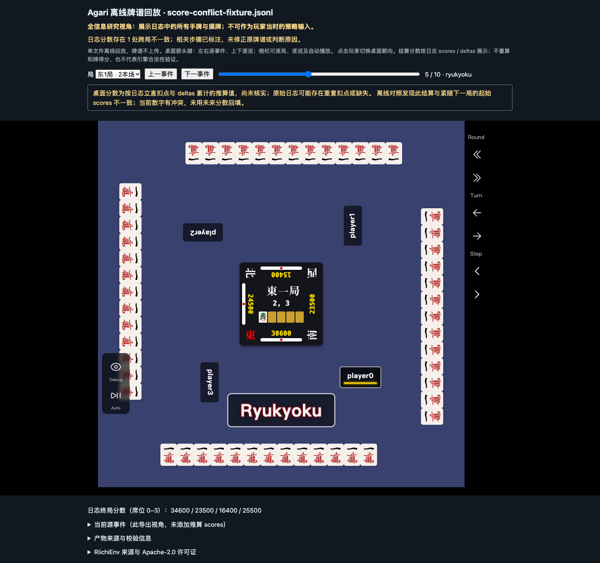

# 分数来源与冲突边界验收

实现提交 `56efbcf5d134027728083b71f8b1251caf136b90`，2026-10-28。
原始投影事件与渲染推算分数分别保存；没有 scores 的结算按原始 deltas 累计并标注“推算，尚未核实”。
紧邻的结算、end_kyoku、下一局起始分数如不一致，显示冲突；只在到达下一局时采用该事件的 scores，
不回填过去、不猜原因。end_game 的剩余供托可能改变终分，因此不用于反推末局。

这是根据上游问题 #247 分数模式构造的显示样本，不宣称牌谱合法，也不重算得分。
两种导出视角均验证源字段保留、推算提示、冲突提示、前后步进和终局分数优先。
[边界机器记录](score-boundary-evidence.json)及[真实训练牌谱回归](evidence.json)均来自禁网 Chrome，
同一真实 train fixture 与原报告一致，未读取 held-out 内容。

普通测试 105 项通过，实际 Chrome 测试 5 项通过；额外独立只读评审核对了连续双 hora、
分数快照不被后续动作修改、终局供托分离和玩家暗牌投影，未发现阻塞问题。
这是结构和显示验收，不替代麻将引擎合法性验证。完整历史含未来事件，不能作为策略输入。

三份机器记录／截图按 SHA256SUMS 逐字节归档；旧版验收原件保持不变。
